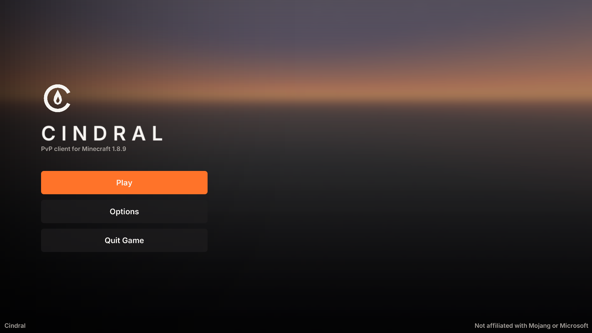
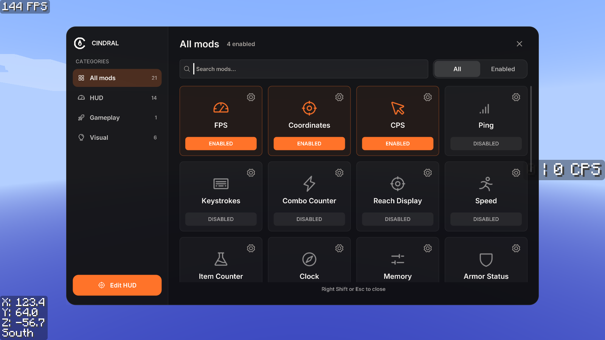
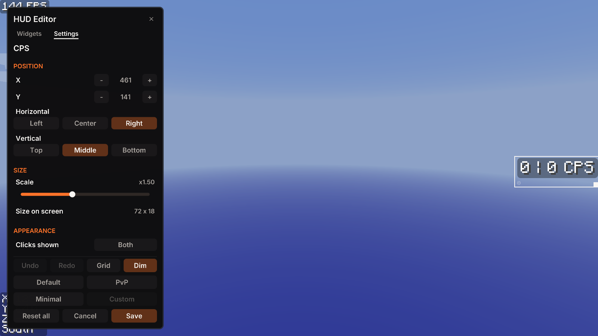

<div align="center">


# Cindral

A Minecraft 1.8.9 PvP client written from scratch in Rust.

**[cindral.aeromv.com](https://cindral.aeromv.com)**

[](https://github.com/aeromv/cindral/releases)
[](#license)




</div>

Cindral is not a mod loader and does not run the Java game. The network code,
the world, the renderer and the interface are its own, so it starts in about
a second, needs no Java, and holds high frame rates on hardware that vanilla
1.8.9 struggles with. It joins any 1.8.8 or 1.8.9 server the way the vanilla
client does.

## At a glance

Measured on a Pentium Gold G5400 with Intel UHD 610 graphics, the kind of PC
most clients are not tested on, with a 32x PvP pack enabled:

| | Cindral 0.5 |
|---|---|
| Window on screen (loading screen) | 0.15 s |
| Textures and resource pack ready | 1.0 to 1.5 s |
| Benchmark scene, 1600x900, render distance 4 | 166 fps (123 in 0.3) |
| 20 players in view, 1600x900 | 160 fps |
| Game ticks | 20 per second, missed ticks caught up as in 1.8 |

## What you get

**A fair client.** Every mod shows information or changes how the game looks.
Nothing clicks, aims, reaches or moves for you, and nothing ever will.

**22 built-in mods**, in one menu (Right Shift), each with its own settings.
See the [list](#mods).

**A HUD you arrange yourself.** Drag any widget, resize it, pin it to a
corner or an edge, snap it to the grid, lock it in place. Each widget has its
own colours, background, outline, opacity, corner radius, padding and text
shadow.
Undo and redo work across the editor, and three layouts are built in
(Default, PvP, Minimal) next to your own.

**Resource packs as you know them.** PvP packs, server packs, and the
OptiFine and MCPatcher features they rely on: connected textures, custom
items, custom skies, custom colours, random and custom mob models, custom
GUIs and fonts, and texture animations.

**Settings that matter for PvP.** The first start sets the video options
for your PC by itself. A Display option lowers the fullscreen resolution and
stretches the picture for more FPS. Video presets, OptiFine-style quality and
performance pages, Dynamic Lights, Smart Animations, a lagometer, per-type
particle switches, and three interface themes (Ember, Amethyst, and Vanilla,
which follows your pack's buttons).

**Accounts.** Microsoft accounts with a switcher, offline mode, and sessions
passed in by a launcher. Discord Rich Presence shows the server you play on
and for how long, with a button that leads your friends to Cindral.

<table>
  <tr>
    <td></td>
    <td></td>
  </tr>
  <tr>
    <td align="center">Mods menu</td>
    <td align="center">HUD editor</td>
  </tr>
  <tr>
    <td></td>
    <td></td>
  </tr>
  <tr>
    <td align="center">Server list</td>
    <td align="center">Video settings</td>
  </tr>
</table>

## Install

**Windows.** Download `cindral-setup-<version>.exe` from
[cindral.aeromv.com](https://cindral.aeromv.com) or the
[latest release](https://github.com/aeromv/cindral/releases/latest) and run
it. It needs no administrator rights, adds Start menu and desktop
shortcuts, and fetches the Minecraft 1.8.8 game files and sounds from Mojang
(about 110 MB, each file checked against Mojang's SHA-1). No Mojang file is
shipped with Cindral. To update, run the new installer over the old one.

**Portable.** `cindral.exe` from the same release also runs on its own. On
the first launch it downloads the game files in the background and shows
the progress on the title screen. Keep `dxcompiler.dll` next to it: shaders
then compile with the DirectX Shader Compiler and the first frame comes
about a second sooner.

**From a terminal**, the files can be fetched ahead of time, and a server
joined directly:

```sh
cindral --setup-assets
cindral play.example.net 25565
```

### Useful options

| Option | What it does |
|---|---|
| `--render-scale 75` | Draw the world at 75 % of the window resolution; the HUD stays sharp. Most useful on integrated graphics. |
| `--preset pvp` | Render distance 4, no frame cap, light effects. Also `low`, `medium`, `high`. Without it, the first start picks one for your PC. |
| `--resource-pack PATH` | Load a pack for this run, on top of the ones you enabled. |
| `--username`, `--uuid`, `--accessToken` | Use a session from a launcher. |
| `--backend dx12` or `vulkan` | Pick the graphics API. Windows uses Direct3D 12 by default. |

Resource packs go in `%APPDATA%\cindral\resourcepacks` on Windows and are
turned on under **Options → Resource Packs**.

## Mods

| HUD | |
|---|---|
| FPS | Frame rate, optionally the frame time |
| CPS | Clicks per second, left, right or both |
| Keystrokes | Movement keys, mouse buttons and space bar, lit while held |
| Ping | Latency to the server |
| Coordinates | Position and facing |
| Direction HUD | A compass ruler along the top of the screen |
| Reach Display | Distance of your last hit |
| Combo Counter | Hits in a row before you are hit back |
| Speed | Blocks per second |
| Item Counter | Splash potions, golden apples, ender pearls and arrows left |
| Armor Status | Each armor piece and the held item, with durability |
| Potion Effects | Active effects with their level and time left |
| Clock | The time of your computer, 12 or 24 hours |
| Memory | Memory the game uses |

| Gameplay and visuals | |
|---|---|
| Toggle Sprint | Sprint stays on, with an optional on-screen indicator |
| Zoom | Hold C to zoom smoothly |
| 1.7 Animations | 1.7 sword blocking and held-item positions |
| Fullbright | Full light in caves and at night |
| No Hurt Cam | No camera tilt when you take damage |
| Hit Color | A deeper red on players you hit, colour and strength adjustable |
| Motion Blur | Three styles of blur when turning |
| Capes | Capes from OptiFine, MinecraftCapes, LabyMod and Cosmetica |

Reach Display and Combo Counter count only the hits the server confirmed.
The Capes mod is on by default; to show capes it sends the names of the
players you meet to those services, so turn it off if you prefer not to.

## Controls

| Key | Action |
|---|---|
| Right Shift | Mods menu and HUD editor |
| F3 | Debug screen; F3 + A, B, D, G, H, T as in 1.8 |
| F2 | Screenshot |
| F5 | Camera view |
| C | Zoom |

Every key can be changed under **Options → Controls**.

## Building

You need a stable [Rust toolchain](https://rustup.rs).

```sh
git clone https://github.com/aeromv/cindral.git
cd cindral
cargo build --release
```

The binary is `target/release/cindral` (`cindral.exe` on Windows). For a
release build, `cargo build --profile dist` takes longer and runs a few
percent faster. On Linux, install the ALSA headers first (`libasound2-dev` on
Debian and Ubuntu).

## Contributing

Bug reports and pull requests are welcome. A pull request should pass:

```sh
cargo fmt --all -- --check
cargo clippy --workspace --all-targets -- -D warnings
cargo test --workspace
```

The code is split into crates by area: `cindral-protocol` and `cindral-net`
for the network, `cindral-world`, `cindral-mesh` and `cindral-render` for the
world and its drawing, `cindral-ui` for the interface, `cindral-game` for the
game rules, `cindral-packext` for the OptiFine pack formats,
`cindral-builtin-mods` for the mods, and `cindral-client`, which builds the
`cindral` binary.

What changed in each version is in [CHANGELOG.md](CHANGELOG.md).

## License

Licensed under either of [Apache License 2.0](LICENSE-APACHE) or
[MIT](LICENSE-MIT), at your option. The title screen uses
[Inter](https://rsms.me/inter/) (SIL Open Font License 1.1).

Cindral is not an official Minecraft product and is not approved by or
associated with Mojang Studios or Microsoft.
