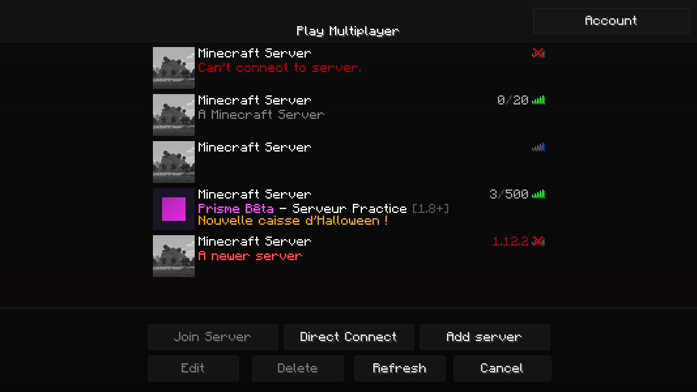
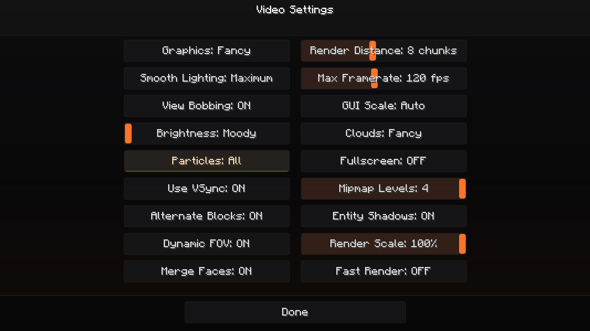
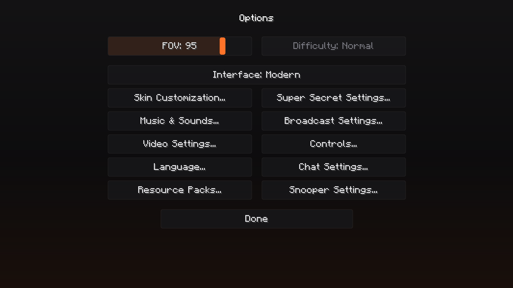

<div align="center">


# Cindral

**A lightweight Minecraft 1.8.9 client for PvP, written in Rust.**

High frame rates on modest hardware, a built-in mod set, and nothing in the way of the game.

[](#license)


</div>

## About

Cindral is a standalone client for Minecraft Java Edition 1.8.9 servers. It
is not a mod loader and does not run on top of the Java game: the networking,
the world, the renderer and the interface are its own, written in Rust on
[wgpu](https://wgpu.rs). It connects to any 1.8.8 or 1.8.9 server the way the
vanilla client does.

It is made for players who want the game to feel instant. A PC with integrated
graphics should hold several hundred frames per second in a PvP arena, and the
client should never stand between your input and the server.

## Features

**Performance**
- A renderer made for weak GPUs: Direct3D 12 on Windows and Vulkan on Linux,
  with merged faces, cave culling and two frames in flight.
- An uncapped frame rate that game logic never stalls: the game runs on its own
  thread at a steady 20 ticks per second.
- A `pvp` video preset: render distance 4, a sharp picture and no frame cap.

**Built-in mods**: one menu, nothing to download (see [Mods](#mods)).

**Interface**
- A modern look for every screen, or the classic Minecraft look that follows
  your resource pack, switchable under **Options → Interface**.
- A drag-and-drop HUD editor: move and resize every widget on screen.
- Resource packs, PvP packs included, and server resource packs.

**Accounts**
- Microsoft accounts with an account switcher, offline mode, and sessions
  passed in by a launcher.

## Screenshots

| | |
|---|---|
|  |  |
| Mods menu and HUD | Server list |
|  |  |
| Video settings | Options |

## Getting started

Cindral needs the official Minecraft 1.8.8 game files. It downloads them from
Mojang the first time (about 110 MB, checked against Mojang's SHA-1 hashes);
no game files are shipped with Cindral.

1. Build it (see [Building](#building)).
2. Download the game files once:
   ```sh
   cindral --setup-assets
   ```
3. Start it:
   ```sh
   cindral
   ```
   The client opens on the title screen. Add a server under **Play**, or connect
   straight away with `cindral play.example.net 25565`.

On the first start Cindral picks a video preset for your graphics card. To use
the PvP preset, start it with `cindral --preset pvp`.

### Resource packs

Put a `.zip` or a pack folder in the `resourcepacks` folder of Cindral
(`%APPDATA%\cindral\resourcepacks` on Windows) and turn it on under
**Options → Resource Packs**.

## Mods

Open the mods menu in game with **Right Shift**. Every mod can be turned on or
off and has its own settings; HUD mods can be placed anywhere on screen.

| Mod | What it does |
|---|---|
| FPS | Frames per second, with an optional frame time |
| CPS | Clicks per second: left, right or both |
| Keystrokes | W, A, S, D, the mouse buttons and space, lit while held |
| Armor Status | Each armor piece and its remaining durability |
| Potion Effects | Active effects with their level and time left |
| Coordinates | Position and facing direction |
| Ping | Latency to the server |
| Reach Display | Distance of your last hit |
| Combo Counter | Hits in a row until you are hit back |
| Toggle Sprint | Sprint stays on while you move forward |
| Zoom | Hold **C** to zoom in smoothly |
| Fullbright | Full light in caves and at night |
| No Hurt Cam | No camera tilt when you take damage |
| Motion Blur | Blur when turning, in three styles |

Reach Display and Combo Counter count only the hits the server confirmed.

Cindral has no autoclicker, reach, velocity or any other feature that gives an
unfair advantage, and it will not get one.

## Controls

| Key | Action |
|---|---|
| Right Shift | Mods menu and HUD editor |
| F3 | Debug screen |
| F2 | Screenshot |
| C | Zoom (with the Zoom mod) |

Every key can be changed under **Options → Controls**.

## Building

You need a recent stable [Rust toolchain](https://rustup.rs).

```sh
git clone https://github.com/aeromv/cindral.git
cd cindral
cargo build --release
```

The binary is `target/release/cindral` (`cindral.exe` on Windows). The `dist`
profile (`cargo build --profile dist`) takes longer to build and runs a little
faster.

On Windows, put `dxcompiler.dll` next to `cindral.exe` for a faster start. It
comes with the [DirectX Shader Compiler](https://github.com/microsoft/DirectXShaderCompiler/releases)
and the Windows SDK (`Redist\D3D\x64`). Without it, Cindral uses the older,
slower shader compiler that ships with Windows.

On Linux, install the ALSA development headers first (`libasound2-dev` on
Debian and Ubuntu).

## Contributing

Issues and pull requests are welcome. Before opening a pull request, check
that these pass:

```sh
cargo fmt --all -- --check
cargo clippy --workspace --all-targets -- -D warnings
cargo test --workspace
```

The workspace is split by area: `cindral-protocol` (packets), `cindral-net`
(connection and session), `cindral-world`, `cindral-mesh`, `cindral-render`,
`cindral-ui`, `cindral-game`, `cindral-builtin-mods`, and `cindral-client`,
which builds the `cindral` binary.

## License

Cindral is licensed under either of [Apache License 2.0](LICENSE-APACHE) or
[MIT](LICENSE-MIT), at your option.

Cindral is a fork of [Umicraft](https://github.com/MATHIP6/umicraft). The title
screen uses [Inter](https://rsms.me/inter/) (SIL Open Font License 1.1).

Cindral is not an official Minecraft product and is not approved by or
associated with Mojang Studios or Microsoft.
